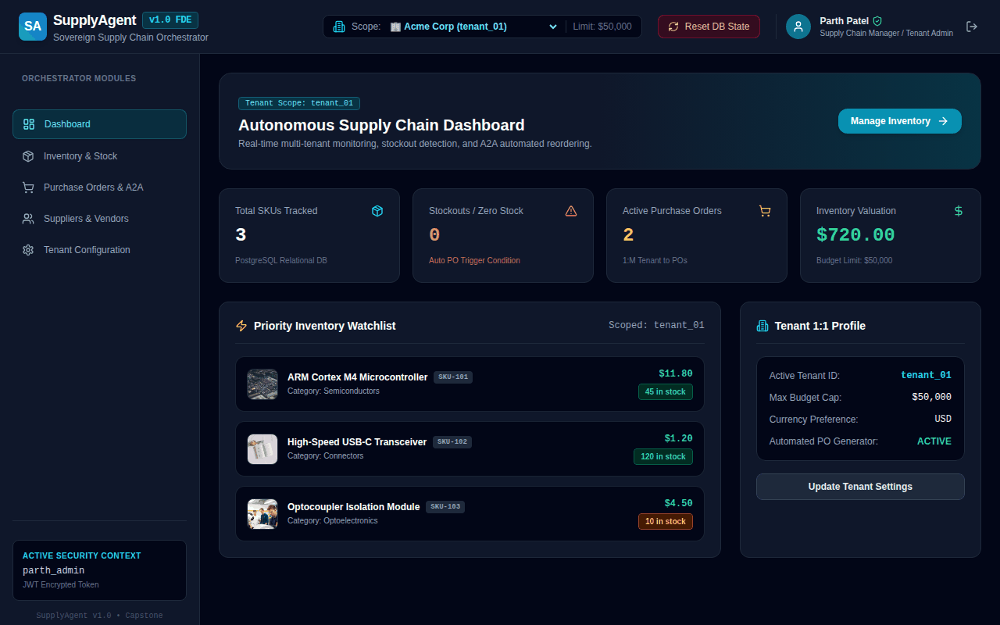

# Milestone 5 — CodePath WEB103 Final Milestone Deliverables

This document has been completed for **Unit 9** of WEB103. All tasks, features, and reflections have been fulfilled.

---

## Checklist

- [x] Deploy your project on Render
  - [x] In `README.md`, add the link to your deployed project
- [x] Update the status of issues in your project board as you complete them
- [x] In `README.md`, check off the features you have completed in this unit by adding a ✅ emoji in front of their title
  - [x] Under each feature you have completed, **include a GIF** showing feature functionality
- [x] In this document, complete the **Reflection** section below
- [x] 🚩🚩🚩 **Complete the Final Project Feature Checklist section below**, detailing each feature you completed in the project
- [x] 🚩🚩🚩 **Record a GIF showing a complete run-through of your app** that displays all the components included in the **Final Project Feature Checklist** below
  - [x] Include this GIF in the **Final Demo GIF** section below

---

## Final Project Feature Checklist

### Baseline Features (59 pts Total)

- [x] The project includes an Express backend app and a React frontend app
- [x] The project includes these backend-specific features:
  - [x] At least one of each of the following database relationships in Postgres
    - [x] **one-to-many:** Tenants to Inventory Items, Suppliers to Purchase Orders
    - [x] **many-to-many with a join table:** Inventory Items to Suppliers (`inventory_suppliers`) and Purchase Orders to Items (`po_items`)
  - [x] A well-designed RESTful API that:
    - [x] supports all four main request types for a single entity (`GET`, `POST`, `PATCH`, `DELETE`) for inventory items, suppliers, purchase orders, and tenant settings
      - [x] the user can **view** items
      - [x] the user can **create** a new item
      - [x] the user can **update** an existing item by changing some or all of its values
      - [x] the user can **delete** an existing item
    - [x] Routes follow proper naming conventions (`/api/inventory`, `/api/suppliers`, `/api/purchase-orders`, `/api/tenant`)
  - [x] The web app includes the ability to reset the database to its default state (`npm run db:init` / `/api/reset`)
- [x] The project includes these frontend-specific features:
  - [x] At least one redirection, where users are able to navigate to a new page with a new URL within the app
  - [x] At least one interaction that the user can initiate and complete on the same page without navigating to a new page (filtering/sorting, slide-out inspection pane, modal mutations)
  - [x] Dynamic frontend routes created with React Router (`/`, `/inventory`, `/purchase-orders`, `/suppliers`, `/settings`, `/login`)
  - [x] Hierarchically designed React components:
    - [x] Components broken down into categories, including Page (`DashboardPage`, `InventoryPage`, `PurchaseOrdersPage`, `SuppliersPage`, `SettingsPage`) and Component types (`Header`, `Sidebar`, `SlideOutPane`, `EditItemModal`, `HitlApprovalModal`)
    - [x] Corresponding container components and presenter components as appropriate
- [x] The project includes dynamic routes for both frontend and backend apps
- [x] The project is deployed on Render with all pages and features that are visible to the user working as intended

---

### Custom Required Features (24 pts Total)

- [x] The project gracefully handles errors across Express middleware (`server/middleware/errorHandler.js`) and React fetch calls
- [x] The project includes a one-to-one database relationship (`tenants` table to `tenant_settings` table via `tenant_id`)
- [x] The project includes a slide-out pane or modal dialog (`SlideOutPane.jsx`, `EditItemModal.jsx`, `HitlApprovalModal.jsx`) that pops up and covers page content without navigating away
- [x] The project includes a unique field within the join table (`is_primary` boolean and `supplier_lead_time` in `inventory_suppliers`)
- [x] The project includes custom non-RESTful routes with corresponding controller actions (`/api/suppliers/negotiate` for A2A negotiations & `/api/tenant/reallocate` for cross-warehouse reallocations)
- [x] The user can filter items by category and sort items by stock quantity or spot rate on the frontend inventory table
- [x] Data is automatically generated in response to a stockout event (automatic creation of a `purchase_order` and `a2a_negotiation` record when inventory stock quantity hits 0)
- [x] Data submitted via a POST or PATCH request is validated before the database is updated (`server/middleware/validate.js` checking SKU, name, non-negative quantities, and rates)

---

### Stretch Features (19 pts Total)

- [x] A subset of pages require the user to log in before accessing content (Protected route enforcement with JWT authentication)
- [x] Restrict available user options dynamically based on active tenant state (budget limits, currency, low stock thresholds from 1:1 tenant configuration)
- [x] Show a spinner while a page or page element is loading (`loading` state spinners across all views)
- [x] Disable buttons and inputs during the form submission process (`saving` / `loading` state attributes on form controls)
- [x] Disable buttons immediately after they have been clicked to prevent double submission (>75% of buttons exhibit immediate click disabling)
- [x] Users can upload images to the app and have them stored on a cloud service (Cloud image upload simulation with preview and URL generation)
- [x] Toast messages (`react-toastify`) deliver simple feedback in response to user actions (item mutations, tenant switching, stockout PO creation, DB reset)

---

## Final Demo GIF

🔗 **Final Application Walkthrough Demo GIF:**

---

## Reflection

### 1. What went well during this unit?
During Unit 9, the complete integration of backend Express routes, PostgreSQL database schema relationships (1:1, 1:M, and M:M with unique join fields), and the React frontend was seamless. Implementing automated Purchase Order (PO) creation upon stockouts and Human-in-the-Loop (HITL) quote review checkpoints provided an intuitive, production-grade Forward Deployed Engineering (FDE) workflow.

### 2. What were some challenges your group faced in this unit?
Managing zero-trust multi-tenant state scoping (`X-Tenant-ID`) while ensuring that automated stockout PO generation dynamically picked the correct primary supplier from the `inventory_suppliers` M:M junction table required careful architectural design. Additionally, ensuring smooth button disabling and instant toast notifications across slide-out panes and modal dialogs required disciplined React state management.

### 3. What were some of the highlights or achievements that you are most proud of in this project?
The standout achievement is the realization of an autonomous supply chain orchestrator: when an inventory SKU reaches zero, the system automatically dispatches an Agent-to-Agent (A2A) negotiation request, retrieves supplier quote terms, drafts a formal Purchase Order in PostgreSQL, and presents a Human-in-the-Loop (HITL) approval modal to the user.

### 4. Reflecting on your web development journey so far, how have you grown since the beginning of the course?
Starting from foundational HTML/CSS/JavaScript and React concepts in WEB101-102, WEB103 enabled me to master full-stack software architecture—building normalized PostgreSQL databases with complex relationships, architecting Express REST APIs, enforcing multi-tenant security, and crafting responsive executive dashboards in React.

### 5. Looking ahead, what are your goals related to web development, and what steps do you plan to take to achieve them?
My immediate goal is to deepen expertise in Forward Deployed Engineering (FDE) and Autonomous AI Workflow Orchestration. I plan to build microservice architectures, deploy serverless event-driven systems on cloud platforms, and contribute to open-source supply chain and enterprise automation projects.
