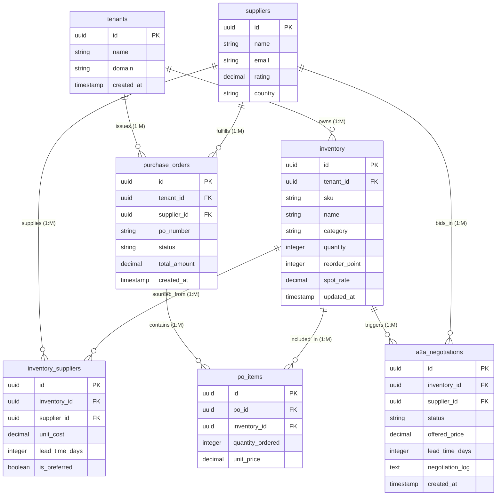

# Entity Relationship Diagram: SupplyAgent (Sovereign Supply Chain Orchestrator)

This document details the PostgreSQL relational database schema for SupplyAgent. The database models enterprise multi-tenant inventory isolation, vendor supplier management, many-to-many supplier item mappings, automated purchase order generation, and Agent-to-Agent (A2A) stockout negotiation task queues.

---

## Database Table Overview

The SupplyAgent database consists of 7 primary tables:

1. `tenants`: Stores enterprise tenant organizations for zero-trust data isolation.
2. `inventory`: Stores tenant-scoped stock items, quantities, reorder thresholds, and spot rates. (1:M with `tenants`)
3. `suppliers`: Stores vendor profiles, contact details, and fulfillment ratings.
4. `inventory_suppliers`: Many-to-Many (M:M) junction table linking inventory SKUs to suppliers with supplier-specific pricing and lead times.
5. `purchase_orders`: Stores draft, pending, approved, and fulfilled purchase orders triggered automatically on stockout events. (1:M with `tenants` and `suppliers`)
6. `po_items`: Many-to-Many (M:M) junction table linking purchase orders to specific inventory line items.
7. `a2a_negotiations`: Logs asynchronous supplier quote requests, agent negotiation transcripts, and HITL approval states.

---

## Entity Relationship Diagram (Mermaid.js)

---

## Relational Schema Mapping & Column Definitions

### 1. Table: `tenants`
Stores isolated organizational tenant entities.

| Column Name | Data Type | Constraints | Description |
|-------------|-----------|-------------|-------------|
| `id` | `UUID` | `PRIMARY KEY`, Default `gen_random_uuid()` | Unique tenant identifier |
| `name` | `VARCHAR(255)` | `NOT NULL` | Organization name (e.g., Acme Corp) |
| `domain` | `VARCHAR(255)` | `UNIQUE`, `NOT NULL` | Tenant domain/slug (e.g., acme.supplyagent.io) |
| `created_at` | `TIMESTAMP` | Default `CURRENT_TIMESTAMP` | Record creation timestamp |

---

### 2. Table: `inventory`
Stores inventory stock items scoped by `tenant_id` for multi-tenant data isolation.

| Column Name | Data Type | Constraints | Description |
|-------------|-----------|-------------|-------------|
| `id` | `UUID` | `PRIMARY KEY`, Default `gen_random_uuid()` | Unique inventory item identifier |
| `tenant_id` | `UUID` | `FOREIGN KEY` -> `tenants(id) ON DELETE CASCADE` | Scoped tenant owner |
| `sku` | `VARCHAR(100)` | `NOT NULL` | Stock Keeping Unit code |
| `name` | `VARCHAR(255)` | `NOT NULL` | Item description/name |
| `category` | `VARCHAR(100)` | `NOT NULL` | Product category (e.g., Microcontrollers) |
| `quantity` | `INTEGER` | `NOT NULL`, `CHECK (quantity >= 0)` | Current stock on hand |
| `reorder_point` | `INTEGER` | `NOT NULL`, Default `50` | Threshold triggering restocking alerts |
| `spot_rate` | `NUMERIC(10,2)` | `NOT NULL` | Current market spot price per unit in USD |
| `updated_at` | `TIMESTAMP` | Default `CURRENT_TIMESTAMP` | Last updated timestamp |

---

### 3. Table: `suppliers`
Stores profiles for vendor suppliers participating in the supply chain network.

| Column Name | Data Type | Constraints | Description |
|-------------|-----------|-------------|-------------|
| `id` | `UUID` | `PRIMARY KEY`, Default `gen_random_uuid()` | Unique supplier identifier |
| `name` | `VARCHAR(255)` | `NOT NULL` | Supplier company name |
| `email` | `VARCHAR(255)` | `NOT NULL` | Supplier contact email |
| `rating` | `NUMERIC(3,2)` | `CHECK (rating >= 0 AND rating <= 5)` | Performance rating (0.00 to 5.00) |
| `country` | `VARCHAR(100)` | `NOT NULL` | Supplier headquarters country |

---

### 4. Table: `inventory_suppliers` (M:M Junction Table)
Maps inventory items to multiple potential suppliers with vendor-specific pricing and lead times.

| Column Name | Data Type | Constraints | Description |
|-------------|-----------|-------------|-------------|
| `id` | `UUID` | `PRIMARY KEY`, Default `gen_random_uuid()` | Junction record identifier |
| `inventory_id` | `UUID` | `FOREIGN KEY` -> `inventory(id) ON DELETE CASCADE` | Associated inventory SKU |
| `supplier_id` | `UUID` | `FOREIGN KEY` -> `suppliers(id) ON DELETE CASCADE` | Associated vendor supplier |
| `unit_cost` | `NUMERIC(10,2)` | `NOT NULL` | Vendor quote price per unit |
| `lead_time_days` | `INTEGER` | `NOT NULL` | Vendor fulfillment lead time in days |
| `is_preferred` | `BOOLEAN` | Default `FALSE` | Preferred vendor flag |

---

### 5. Table: `purchase_orders`
Stores formal purchase orders issued by tenants to suppliers during stockout reordering.

| Column Name | Data Type | Constraints | Description |
|-------------|-----------|-------------|-------------|
| `id` | `UUID` | `PRIMARY KEY`, Default `gen_random_uuid()` | Unique Purchase Order identifier |
| `tenant_id` | `UUID` | `FOREIGN KEY` -> `tenants(id) ON DELETE CASCADE` | Scoped tenant issuing PO |
| `supplier_id` | `UUID` | `FOREIGN KEY` -> `suppliers(id)` | Fulfillment supplier |
| `po_number` | `VARCHAR(100)` | `UNIQUE`, `NOT NULL` | Human-readable PO number (e.g. PO-2026-01) |
| `status` | `VARCHAR(50)` | `NOT NULL`, `CHECK (status IN ('Draft', 'Pending', 'Approved', 'Fulfilled', 'Cancelled'))` | PO lifecycle state |
| `total_amount` | `NUMERIC(12,2)` | `NOT NULL` | Total Purchase Order cost in USD |
| `created_at` | `TIMESTAMP` | Default `CURRENT_TIMESTAMP` | Order creation timestamp |

---

### 6. Table: `po_items` (M:M Junction Table)
Line items contained within each Purchase Order.

| Column Name | Data Type | Constraints | Description |
|-------------|-----------|-------------|-------------|
| `id` | `UUID` | `PRIMARY KEY`, Default `gen_random_uuid()` | Line item record identifier |
| `po_id` | `UUID` | `FOREIGN KEY` -> `purchase_orders(id) ON DELETE CASCADE` | Associated Purchase Order |
| `inventory_id` | `UUID` | `FOREIGN KEY` -> `inventory(id)` | Purchased inventory item |
| `quantity_ordered` | `INTEGER` | `NOT NULL`, `CHECK (quantity_ordered > 0)` | Ordered quantity |
| `unit_price` | `NUMERIC(10,2)` | `NOT NULL` | Agreed unit price |

---

### 7. Table: `a2a_negotiations`
Logs Agent-to-Agent (A2A) supplier quote negotiations dispatched on stockout conditions.

| Column Name | Data Type | Constraints | Description |
|-------------|-----------|-------------|-------------|
| `id` | `UUID` | `PRIMARY KEY`, Default `gen_random_uuid()` | Unique negotiation ID |
| `inventory_id` | `UUID` | `FOREIGN KEY` -> `inventory(id) ON DELETE CASCADE` | Stockout inventory item |
| `supplier_id` | `UUID` | `FOREIGN KEY` -> `suppliers(id)` | Negotiating supplier vendor |
| `status` | `VARCHAR(50)` | `NOT NULL`, `CHECK (status IN ('Requested', 'Quoted', 'HITL_Review', 'Accepted', 'Rejected'))` | Negotiation status |
| `offered_price` | `NUMERIC(10,2)` | `NOT NULL` | Supplier offered price per unit |
| `lead_time_days` | `INTEGER` | `NOT NULL` | Supplier promised lead time |
| `negotiation_log` | `TEXT` | `NULLABLE` | JSON or textual log of agent quote exchanges |
| `created_at` | `TIMESTAMP` | Default `CURRENT_TIMESTAMP` | Timestamp negotiation was initiated |
